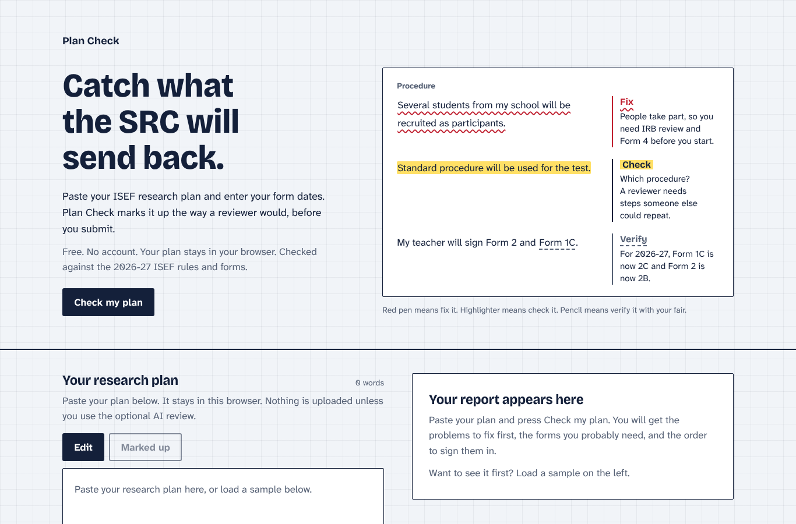

# Plan Check

A free pre-reviewer for ISEF research plans. Upload your plan as a PDF or Word file (or paste it), confirm what your project involves and the dates on your signed forms, and Plan Check marks up your plan the way a Scientific Review Committee (SRC) reviewer would, before you submit.



## Why

Getting an ISEF project approved means a research plan plus a stack of forms (1, 1A, 1B, 2A, 3, 4, 5A, 6A and more), each signed and dated in the right order before you start. Plans come back for the same reasons every year: forms dated after the start date, a missing risk and safety section, "standard procedure" with no detail, bare links in the bibliography, a survey of classmates with no IRB review. The 2026-27 forms also renumbered (Form 1C is now 2C, Form 2 is now 2B), so old guides are wrong. I built this after going through it myself.

## What it checks

- **Dates and approvals (exact checks).** Every form that must be signed before experimentation is compared with your Form 1A start date. Forms completed after (2C, 5B, 7, final SRC review) are checked the other way. Fair deadlines and the 12-month project window are checked too.
- **Forms you need.** From what your project involves (people, vertebrate animals, biological agents, hazards, an outside lab, a continuation, AI use), with the 2026-27 numbers and the order to sign them.
- **The plan itself (pattern checks).** Required sections, procedure detail (quantities, trials, controls, who does what), vague wording, safety coverage of the hazards you mention, a named analysis method, bibliography format and in-text citations, old form numbers, human-participant and biological-agent details, AI-use disclosure.
- Every finding quotes the exact sentence from your plan, says why a reviewer cares, links the official source, and asks a question instead of rewriting your text.

Three severities, drawn the way a reviewer marks paper: **Fix** (red pen), **Review** (highlighter), **Verify** (pencil: a rule I could not confirm from an official source, so ask your fair). A pattern check that does not fit your project can be marked **Doesn't apply**, which takes it out of the count. Missing dates are listed separately under **Still needed from you**, so the count is only problems with the plan.

## How it works

1. **Your plan.** Upload a PDF or Word file, drop it on the page, or paste the text.
2. **Confirm.** Plan Check ticks what it found in your plan (people, animals, hazards, AI use and more) and shows the words it matched. Fix any tick it got wrong and add the dates on your signed forms. Only the forms your project needs are listed.
3. **Report.** Problems grouped by Fix, Review and Verify, the forms you need, and the order to sign them, each on its own tab. On a computer the marked-up plan sits beside the report; on a phone a mark opens its note in a sheet over the plan.

Everything updates live: change the text, a tick or a date and the report follows.

## Privacy

The rule engine runs entirely in your browser. PDF and Word files are read on your own computer with pdf.js and mammoth, and your plan is never uploaded. Your plan, ticks and dates are saved in your own browser (localStorage) so they are there when you come back. **Clear my data** removes them.

The optional AI review is the only thing that would send your plan anywhere (to Claude through the Vercel AI Gateway). It is hidden unless the site owner turns it on, and even then it is off until you tick a consent box. It only asks questions tied to exact sentences in your plan and never writes or rewrites text, because ISEF does not allow generative AI to write the plan. It produces an AI-use log you can copy for Form 2A. ISEF allows AI feedback on your own finished draft when you disclose it, but some fairs and teachers are stricter, so ask yours first.

## Honest limits

- Plan Check is a pre-check. It cannot approve anything. Only your fair's SRC or IRB can.
- Pattern checks are heuristics. They will sometimes flag something that is fine, or miss something. Each one says it is a pattern check.
- Rules were last checked in October 2026 against the ISEF 2026-27 International Rules and the 2027 forms. Anything not confirmed from an official source is marked Verify.
- The two samples in the app are invented. The engine is also tested against seven real, publicly posted sample plans in `fixtures/real/` (sources in `fixtures/real/SOURCES.md`) to find false positives.

## Run it

```bash
npm install
npm run dev        # http://localhost:3000
npm test           # dates, sections, bibliography, detection, PDF reading, app state, real plans
npm run preflight  # typecheck, lint, tests, README and placeholder checks
npm run preflight -- --url https://your-deployment.vercel.app
```

The AI review panel is hidden by default. To show it, set `NEXT_PUBLIC_AI_REVIEW=1` (Vercel: Settings, Environment Variables, then redeploy). It needs the Vercel AI Gateway with credits on the account: on Vercel it authenticates automatically, and locally you set `AI_GATEWAY_API_KEY`. Set `DEMO_MODE=1` to return a canned review with no model call.

## How it is built

Next.js 16 (App Router), React 19, TypeScript, Tailwind CSS v4, AI SDK 7 with zod structured output. The rule engine is plain TypeScript in `lib/engine/` with no dependencies, so it can run anywhere. Components are hand-built rather than from a UI kit.

Built by Conrad Spaudie with help from Claude (Anthropic) for research, code and testing.
